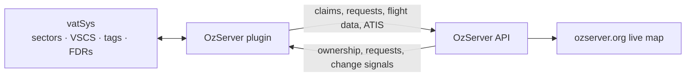

# OzServer Plugin

[](https://github.com/JoshuaMicallefYBSU/OzServer-Plugin/releases)


A [vatSys](https://virtualairtrafficsystem.com/) plugin that gives every controller the same
picture of **who owns which sector** — and lets sectors, and the aircraft in them, move between
controllers without anyone leaving the scope.

Claim a sector by transmitting on its frequency, extending into it, or logging on under its
callsign. Ask another controller for one they hold. When a sector changes hands, its aircraft go
with it. Everything is kept in step through the [OzServer API](https://github.com/JoshuaMicallefYBSU/OzServer-API),
and shown publicly on the live map at [ozserver.org](https://ozserver.org).

> [!NOTE]
> Expect frequent updates — the plugin installs them itself.

## Contents

- [Features](#features)
- [Installation](#installation)
- [Updates](#updates)
- [Using OzServer](#using-ozserver)
- [Settings](#settings)
- [Troubleshooting](#troubleshooting)
- [Building from source](#building-from-source)
- [Releasing](#releasing)
- [How it works](#how-it-works)
- [Security](#security)
- [Contributing](#contributing)

## Features

### Sector ownership

| | |
| --- | --- |
| **Two-way sync** | Anything that changes the sectors you control in vatSys — logging on, the Sectors window, a VSCS transmit press, another plugin — is claimed on OzServer. Anything gained or lost on OzServer is applied to vatSys and your VSCS lines. The two are reconciled every few seconds. |
| **Sector requests** | Ask another controller for a sector they own. They accept or reject from their Sectors window; a rejection is reported back to you. |
| **Conflict prompts** | Claiming airspace someone else holds opens a prompt showing what is owned and by whom, and asks whether to send a request. The uncontested part is yours either way. |
| **Primary positions** | Log on while someone is covering your position and your client sends them one request for all of it. Nothing moves until they accept. |
| **Request indicators** | An incoming request flashes the Settings menu, badges the Sectors window, plays vatSys's ATC-message tone, and shades the requested airspace on your scope — yellow incoming, light green outgoing. |
| **Observers** | An observer claims nothing, and sees the airspace of the controller they are watching. |

### Aircraft and flight data

| | |
| --- | --- |
| **Tags follow sectors** | When a sector changes hands, the aircraft its previous owner held inside it are handed to the new owner and accepted automatically, with their cleared level, scratchpad and label data. |
| **Transfer preview** | While a sector is staged or requested, the aircraft that would come with it are drawn as ghost jurisdiction. |
| **Shared flight data** | Flight plans, positions and label data for the aircraft you hold are shared with OzServer, so another controller's scope and the public map agree with yours. |
| **Couple assist** | Couples an activated flight plan to the radar track with the same callsign when vatSys's own route check will not. |
| **Shared Arrival Lists** | The Arrival List (`A:YSSY List`) is OzServer's own window in place of vatSys's: every departed flight inbound, with its landing time, type and global ops, in one order for every controller. Anyone can reorder it unless the airport's FMP (`SY_FMP` for YSSY) is online, and then only the FMP can. Two badges above the list show how many controllers have it open (hover for who) and whether the FMP is online. Global ops can be edited from the list by any controller, up to the FDR's 15 characters. |
| **Controllers without the plugin** | A controller connected without OzServer (`ML-TBD_CTR` on plain vatSys) still holds their airspace: their position, whatever their information lines say they are covering ("Extending MUN, GUN"), and the sectors their frequencies stand for, matched only to a sector of their own kind and unit. Those sectors show as controlled (marked "no plugin") and nothing can be requested from them, as there is no plugin on their end to answer. Once that controller has handed one to you or logged off, transmitting on it or moving it across in the Sectors window asks whether to take it, with a reminder that coordination and tag handoffs have to be done manually. The live map tints them light orange. |
| **ATIS** | Your ATIS — vatSys's own, and every [ATISPlugin](https://github.com/badvectors/ATISPlugin) broadcast — is published as it changes. |

### Resilience

| | |
| --- | --- |
| **Deliberate disconnect** | Closing vatSys or pressing Disconnect releases your sectors immediately. |
| **Dropped connection** | After a crash or network drop your sectors stay yours for five minutes unless someone claims them. Reconnect in that time and your sectors, transmit lines, tags and traffic picture are restored. |
| **Controller changes** | A controller logging on as your position within two minutes of you leaving takes over its sectors and the tags inside them. |
| **Network separation** | The live network and each SweatBox server are kept completely apart. |
| **Disable switch** | **Tools → Disable OzServer** takes OzServer out of your session entirely and restores plain vatSys until the next restart. |
| **Automatic updates** | New releases install themselves and take effect the next time vatSys starts. |

## Installation

**Requirements:** vatSys, with an Australian or Pacific profile.

Install OzServer **once per profile**, in one place only. If vatSys finds two copies it uses only
one of them, and OzServer names both in the Errors window. Delete the one you don't want.

### With the vatSys Launcher

1. Close vatSys.
2. In the [vatSys Launcher](https://github.com/badvectors/vatSysLauncher), open **Plugins**, choose
   `JoshuaMicallefYBSU/OzServer-Plugin` and your profile (not **All**), and press **Install**.
3. Start vatSys.

The launcher installs into `Profiles\<your profile>\Plugins\OzServer-Plugin\`. If you installed
OzServer by hand before, delete that copy first. While OzServer is being trialled it may only be
listed with the launcher's development plugins turned on.

### Manually

1. Download `OzServerPlugin-v<version>.zip` from the
   [latest release](https://github.com/JoshuaMicallefYBSU/OzServer-Plugin/releases/latest).
2. Unzip it into a folder called `OzServer-Plugin` in your profile's plugin folder:

   ```
   Documents\vatSys Files\Profiles\<your profile>\Plugins\OzServer-Plugin\
   ```

   This is the folder the launcher uses, so the launcher recognises the install and can update it
   later.
3. Restart vatSys.

> [!TIP]
> If Windows has blocked the downloaded file, right-click the zip, choose **Properties**, and tick
> **Unblock** before unzipping it.

### From source

See [Building from source](#building-from-source). Copy the built `OzServerPlugin.dll` into the
same `Plugins\OzServer-Plugin\` folder.

Once loaded, the plugin adds:

| Menu | Entry |
| --- | --- |
| **Settings** | **Sectors** — opens the OzServer Sectors window, in place of vatSys's own *Sectors...* entry while OzServer is running |
| **Tools** | **Disable OzServer** |
| **OzServer How-To** (menu bar) | Opens the [controller guide](https://ozserver.org/how-to) in vatSys's browser |

## Updates

You only install the plugin once. After that it keeps itself up to date: it checks as soon as
vatSys opens and every five minutes afterwards. The vatSys Launcher can also update it, while vatSys
is closed. It usually finds the plugin already current.

An update never disturbs a running session. It is downloaded, verified, and put in place for the
**next vatSys start**. When one has been installed an **OzServer update** window tells you a new
version has been found. Its **Restart** button closes vatSys and opens it again for you. Because
the check runs as vatSys opens, that is usually before you have connected.

If a new version ever fails to load, the previous one is still beside it as
`OzServerPlugin.dll.backup` — close vatSys, delete `OzServerPlugin.dll`, and rename the backup
back.

How the updater chooses and verifies a release is described under [Security](#security) and in
[docs/architecture.md](docs/architecture.md#self-update).

## Using OzServer

### The Sectors window

**Settings → Sectors** opens it. It has three panes:

| Pane | Shows |
| --- | --- |
| **Owned** | The sectors OzServer records as yours. A sector that bundles others is marked `*`, with its sub-sectors nested beneath. |
| **Requested Changes** | `Requested By Me` and `Requested From Me`. |
| **Available / Controlled** | Toggles between sectors nobody holds and sectors another controller holds, with their callsign. |

Sectors are grouped under **Flow / Centre / Approach / Tower / Other**.

Nothing is sent until you press **Apply**. Moving a sector only *stages* it, shown in yellow.

| Control | Action |
| --- | --- |
| `<<` | Stage the selected Available sector into Owned |
| `>>` | Stage the selected Owned sector out |
| **Apply** | Commit everything staged: claim what is free, release what you removed, and request anything another controller owns |
| **Cancel** | Discard the staged changes |
| **Accept** / **Reject** | Answer the selected incoming request — or every incoming request, with the `Requested From Me` heading selected |

### Claiming by transmitting

Pressing **Transmit** on a VSCS line is the usual way to claim:

- A **sub-sector's** line (for example `SNO`) claims only that sector.
- A **primary's** line (for example `WOL`) claims it and its whole group.

Dropping the line to **Idle** releases the sector for everyone else. **Receive** keeps it — you are
still listening, so the airspace and its aircraft stay yours.

Your own logged-on position is never released this way.

### Requests and conflicts

If the airspace you are claiming is held by someone else, a prompt shows what is owned and by whom.
Choose **Accept** to send them a request, or **Reject** to take only the uncontested part. Nothing
is ever requested without that answer.

When a request arrives for you, the Settings menu flashes, a tone plays and the requested airspace
is shaded on your scope. No window is put over your traffic: answer it from the Sectors window when
you are ready. Accepting hands over the sector and the aircraft you hold inside it.

### Disconnecting and reconnecting

| What happened | What OzServer does |
| --- | --- |
| You closed vatSys or pressed Disconnect | Your sectors are released immediately, and your tags are left with nobody |
| vatSys crashed or the connection dropped | Your sectors stay yours for five minutes, unless someone else claims them |
| You reconnected within five minutes | Sectors, transmit lines, tags and traffic are restored — except anything someone has taken since |
| Someone logged on as your position within two minutes | They take over your position's sectors and your tags inside them. Sectors you were extending into, and their tags, are not part of it |
| Anyone else took one of your sectors | The sector is theirs; your tags in it are left with nobody |
| Five minutes passed | Your sectors go to whoever is covering the position above, or become available. Your tags are left with nobody |

A tag left with nobody is still shown on everyone's scope — OzServer activates every flight it has
seen in the last 15 minutes — but it is never taken into anyone's jurisdiction automatically.
Whoever now holds the airspace picks it up. Tags only move by themselves in a sector handover, your
own reconnect, or a controller change on a position within two minutes.

### Turning it off

**Tools → Disable OzServer** releases your sectors, stops all communication with OzServer, stops
the plugin changing anything in vatSys, and brings back vatSys's own Sectors window. It lasts until
vatSys is restarted.

## Settings

There is nothing to configure. The plugin always talks to `https://api.ozserver.org`.

## Troubleshooting

**Where is the log?** The plugin writes a daily log to
`Documents\vatSys Files\ozserver_<yyyymmdd>.txt`. Attach it to any
[bug report](https://github.com/JoshuaMicallefYBSU/OzServer-Plugin/issues/new/choose).

| Symptom | Things to check |
| --- | --- |
| No OzServer entries under Settings | The DLL is in the profile's `Plugins\OzServer-Plugin` folder and is not blocked by Windows |
| "Installed more than once" in the Errors window | vatSys found more than one copy and is using only one. Close vatSys, delete the copies the message says are ignored, and restart |
| Sectors are not syncing | You are connected to the live network or a SweatBox server; OzServer has not been disabled this session; the Errors window for a connection message |
| A sector you expect is taken | The **Controlled** view shows who holds it — send a request |
| Something is badly wrong mid-session | **Tools → Disable OzServer** returns you to plain vatSys immediately |

If a problem involves two controllers, say what the other controller was holding and doing — most
of what this plugin does is two clients agreeing with each other.

## Building from source

**Requirements:** the .NET SDK (or Visual Studio 2022) with .NET Framework 4.7.2 targeting, and a
local vatSys installation. The project compiles against vatSys's own assemblies, which are not
redistributed here.

```bash
dotnet build OzServerPlugin/OzServerPlugin.csproj -c Release
```

vatSys is located through the registry. For a non-default installation, pass its path:

```bash
dotnet build OzServerPlugin/OzServerPlugin.csproj -c Release -p:VatSysPath="D:\vatSys"
```

The output is a single `OzServerPlugin.dll`, built for x86 to match vatSys. To build straight into
a profile's `Plugins` folder, set `OutputPath` on the command line or in a git-ignored
`OzServerPlugin.csproj.user`.

## Releasing

Releases are built with [`Release.ps1`](Release.ps1) and published on GitHub. The plugin's own
updater and the vatSys Launcher both install from there.

1. Raise `<Version>` in `OzServerPlugin/OzServerPlugin.csproj` (`MAJOR.MINOR.PATCH`), add the
   release to [CHANGELOG.md](CHANGELOG.md), then commit and push.
2. Run `.\Release.ps1` from that commit. It refuses uncommitted changes, an unpushed commit or an
   existing tag, builds Release into `artifacts\build\`, checks the DLL's name and version, and
   writes:
   - `artifacts\OzServerPlugin-v<version>.zip`: `OzServerPlugin.dll` and `LICENSE.txt` at the zip
     root, for the launcher and manual installs
   - `artifacts\OzServerPlugin.dll`: the bare DLL, which the self-updater downloads
3. Publish a GitHub release tagged `v<version>` at that commit, titled `OzServer Plugin v<version>`,
   with both files attached. Attach the zip first. Publish it as a normal release marked latest:
   the launcher only sees GitHub's latest release, and that never includes a pre-release or a draft.
   The script prints the `gh release create` command, with the commit as its `--target`.
4. Check it with `gh api repos/JoshuaMicallefYBSU/OzServer-Plugin/releases/latest`.

VATPAC's plugin list picks up the new release by itself. [CONTRIBUTING.md](CONTRIBUTING.md#publishing-a-release)
covers what else publishing sets off (the Discord announcement, every client's self-update), and
how to pause a rollout.

## How it works

OzServer's record is the single source of truth for ownership. Every action calls the API and then
re-reads the result rather than assuming what it must have been.



- **Ownership** is polled every three seconds and re-read immediately when the API signals a
  change over a Server-Sent Events stream.
- **Releases are explicit.** A sector is only ever released by a VSCS line going idle, an applied
  change in the Sectors window, a conflict you declined, your position's own controller already
  being online when you connect, or a deliberate disconnect — never inferred from a sector simply
  disappearing from vatSys.
- **Flight data** is pushed in five-second batches, only for aircraft you hold.

[docs/architecture.md](docs/architecture.md) covers the source layout, the API endpoints used,
timings, the self-update mechanism and the vatSys behaviours the code depends on.

## Security

- **Identity.** The plugin identifies you to OzServer by the CID and callsign of your vatSys
  session. OzServer is a coordination service between cooperating controllers; it does not
  authenticate them independently.
- **Transport.** All traffic is HTTPS. Plain HTTP is accepted only for a server on the local
  machine.
- **Updates.** The updater asks OzServer which release to install and falls back to GitHub's API if
  OzServer cannot answer. Whichever answers, the file is downloaded only from this repository's
  GitHub releases, checked against its published SHA-256, and installed only if it is a genuine
  `OzServerPlugin` assembly with a higher version than the one running. Releases are not
  code-signed, so **write access to this repository is the trust boundary** for what runs in
  every controller's vatSys.
- **Logs.** Plugin log lines other than raw API calls are forwarded to OzServer so a problem
  between two controllers can be read from both sides, and errors are relayed to the maintainers
  as they happen. They include your CID and callsign.

To report a security problem, please contact the maintainers privately rather than opening a
public issue.

## Contributing

Bug reports and pull requests are welcome — see [CONTRIBUTING.md](CONTRIBUTING.md), which also
covers how releases are published.

Related repositories:

- [OzServer-API](https://github.com/JoshuaMicallefYBSU/OzServer-API) — the backend this plugin
  talks to.
- [OzServer-Website](https://github.com/JoshuaMicallefYBSU/OzServer-Website) — ozserver.org and its
  live map.

## Acknowledgements

The VSCS transmit handling is adapted from
[badvectors/VatpacPlugin](https://github.com/badvectors/VatpacPlugin), and ATIS publishing reads
from [badvectors/ATISPlugin](https://github.com/badvectors/ATISPlugin) where it is installed.

## Licence

[MIT](LICENSE). The bundled [Clipper2](OzServerPlugin/ThirdParty/Clipper2) is under the Boost
Software License 1.0.
